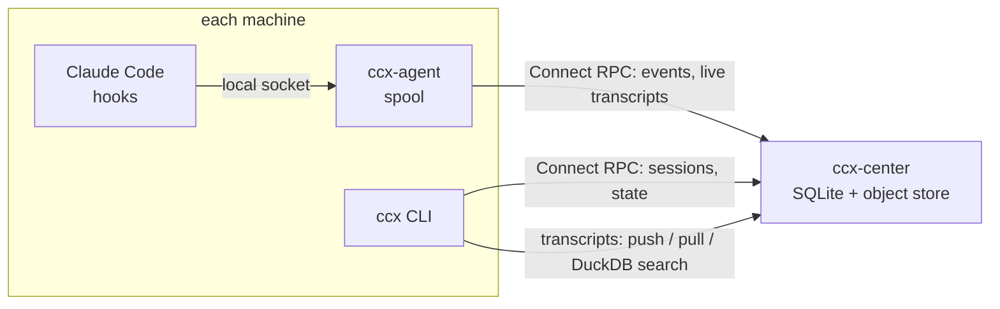

# ccx

Integrated management for parallel AI coding sessions.

[](https://github.com/TakashiAihara/ccx/actions/workflows/ci.yml)
[](https://github.com/TakashiAihara/ccx/releases)
[](LICENSE)

- **Repodirs** — a full, independent clone per session, made in a tenth of a second from a local mirror, and reclaimed safely when done.
- **Sessions across machines** — a resident agent forwards each machine's Claude Code hook events to one center, so one CLI lists every session on every machine that runs the agent.
- **Transcripts that travel** — push a finished session's transcript to the center, resume it on another machine, and search all of them with the DuckDB built into the binary.

Running several AI coding agents at once needs several independent working copies of the same
repository. The usual answer is `git worktree`, but a worktree binds one directory to one branch:
you cannot check out the same branch twice, submodules are awkward, and every worktree stays
tethered to a parent directory.

`ccx` takes the other road. A **repodir** is a full, independent clone — so the same branch can be
checked out in as many repodirs as you like, submodules behave normally, and nothing is tethered.

The cost that usually makes clones unattractive is paid off with a **bare mirror and hardlink
clones**. One never-checked-out copy of the history per repository; every repodir clones from it
locally, sharing `.git` objects at the inode level. A 117 MB repository takes 19 seconds to clone
from a forge and **0.07 seconds** from its mirror.

That speed is the point, and not for comfort. When a fresh working copy costs twenty seconds and a
120 MB download, people keep the ones they have — which is exactly how the 55 directories that
motivated this tool piled up. When it costs a tenth of a second, throwing one away costs nothing,
because getting it back costs nothing. **Reclamation is only credible because creation is nearly
free.**

## How it fits together

| component | language | runs | does |
|---|---|---|---|
| `ccx` ([`apps/cli`](apps/cli)) | TypeScript on Bun, compiled to one binary | on demand | repodirs, session state, transcripts, search |
| `ccx-agent` ([`apps/agent`](apps/agent/README.md)) | Go | one per machine, as your user | takes hook events over a local socket, spools them, forwards them; appends running sessions' transcripts; keeps opted-in idle sessions' prompt caches warm |
| `ccx-center` ([`apps/hub`](apps/hub/README.md)) | TypeScript on Bun (Hono, Drizzle, SQLite) | one per fleet | stores events and session state, serves an S3-compatible object API for transcripts |

`ccx` alone manages repodirs on one machine. Add `ccx-agent` and `ccx-center` to see across machines.



`ccx-agent` and `ccx` talk to the center over [Connect](https://connectrpc.com) RPC defined once in [`packages/proto`](packages/proto) (Go and TypeScript are generated from it). When the center is down, the agent keeps events in its spool and sends them in order once it is back; nothing on the machine waits for it.

```text
apps/cli        ccx — the CLI
apps/agent      ccx-agent — the resident agent (Go)
apps/hub        ccx-center — the data sink
packages/core   repodir, mirror, config and transcript logic for the CLI; its Go config resolver is shared with ccx-agent
packages/proto  the RPC schema and its generated Go / TypeScript
docs/design     why it is built this way: scope, architecture, the transcript store
```

## Install

From source, which needs [Bun](https://bun.sh) but nothing else:

```bash
git clone https://github.com/TakashiAihara/ccx && cd ccx
bun install                    # also fetches the DuckDB library + httpfs extension into .build/duckdb
bun run install:local          # builds, then installs to ~/.local/bin/ccx
```

Set `CCX_INSTALL_DIR` to put it somewhere else.

Releases are published as release candidates (the badge above); the compiled binary can be fetched directly — it carries no runtime
dependency, so Bun is not needed on the target machine:

```bash
curl -fsSL https://raw.githubusercontent.com/TakashiAihara/ccx/main/scripts/install.sh | sh
```

`CCX_VERSION` pins a version; `CCX_INSTALL_DIR` chooses the destination.

To see sessions across machines, add the resident agent too. `--with-agent` installs `ccx-agent` from
the same release and, where `systemctl --user` works, runs it as a systemd **user** service (never a
system unit; elsewhere it says how to supervise it yourself). The hooks and the center URL
are separate steps, in [apps/agent/README.md](apps/agent/README.md#install):

```bash
curl -fsSL https://raw.githubusercontent.com/TakashiAihara/ccx/main/scripts/install.sh | sh -s -- --with-agent
```

## Usage

```bash
# Create a repodir. Prints its path on stdout, so you can cd straight into it.
cd "$(ccx repodir new owner/repo --task 'fix the flaky test')"

# rd is an alias
ccx rd new owner/repo --from develop --issue owner/repo#123 --reviewer someone

# Go back to one. Pick it by what it was created for — the id is never typed.
ccd() {
  local dir
  dir="$(ccx rd cd)" || return   # nothing picked: stop here, do not cd
  cd "$dir"
}
```

### Seeing across machines

Once a resident agent (`ccx-agent`) is collecting and a `ccx-center` is up, the same CLI reads what they
gathered. Both are optional: without them, everything above still works, you just have no view
across machines. Setting up the agent is in [apps/agent/README.md](apps/agent/README.md#install).

```bash
ccx agent status              # is the local ccx-agent up, how much is waiting, can it reach the center
ccx session ls                # every session the center knows about, newest activity first
ccx session ls --active       # only those with no SessionEnd observed
ccx session show <id>         # what one session did, newest first
ccx session show <id> --hook PostToolUse --payload
```

`--active` means exactly one thing: no `SessionEnd` has been observed. It is **not** a liveness
check — a session whose machine lost its ccx-agent, or that was killed, never sends one either. Read the
age column alongside it.

### What ccx holds about a session

A session's state is ccx's to keep (`docs/design/scope.md`), and it needs no center: the declared
part lives as files under `~/.claude/sessions/<id>/`, the observed part is read from pids, local
transcripts and the store.

```bash
ccx session mark archived     # this session (CLAUDE_CODE_SESSION_ID); or give an id / unique prefix
ccx session mark archived --off <id>
ccx session label "scope｜step"
ccx session task "kaneo ccx#1"
ccx session role worker       # what the session is; free text, ccx gives it no meaning
ccx session meta set done     # your own keys; ccx gives them no meaning (~/.claude/sessions/<id>/meta/<key>)
ccx session meta set owner=alice
ccx session meta get owner      # prints alice; exit 1 when the key is not set, 2 when it cannot be read (read this, not the file)
ccx session meta unset done
ccx session status [id]       # lifecycle (running / ended / remote) + flags, label, task, role, metadata
```

Observed: `running` (a live pid), `ended` (a transcript here, no pid), `remote` (no transcript
here, a copy in the store), `unknown` (no transcript here and no store to ask). Declared:
`archived` (folded away — the word the Claude Desktop app uses; the only flag, on purpose), a
free-text `label`, one external `task` reference and a free-text `role`. `ccx session ls` and `ccx tr ls` show them;
`ccx tr push` carries them as `state.json` next to the transcript and `ccx tr pull` sets them on a
machine that holds none yet (marks already set there are never overwritten). With a center
configured, every `mark` / `label` / `task` / `role` also reports the state there, so `ccx session ls` shows
other machines' and users' flags from the center's own database (this machine's rows come from its
own files, plus one store GET to tell `remote` from `unknown`). What you *do* with
`archived` — fold it, push and prune it, close it — stays yours; ccx only holds and carries it.

Point the CLI at a center the same way `ccx-agent` is pointed at one (`CCX_HUB_URL` / `ccx.hubUrl` /
`hub.url`). With none set, `ccx session` exits `3` and says so; it does not pretend the fleet is
empty.

### Opening a stopped session again

```bash
ccx session resume <id>                 # a new herdr workspace on the cwd its transcript records (a unique prefix works)
ccx session resume <id> --force         # also when it is archived
ccx session resume <id> --wait 90 --json
ccx session resume <id> -m d1           # have that machine's ccx-agent open it there, through the center (full id only)
ccx session resume <id> -m d1 -u alice  # ... for that user there
ccx session ls --stopped                # what can be opened again, on any machine the center knows
```

Here it needs [herdr](https://herdr.dev), the transcript on this machine (`ccx tr pull` it first
if it is only in the store) and its cwd still in place, and neither a center nor `ccx-agent`. It
refuses a session that is running here; it cannot see one running on another machine. In the new
pane it runs `claude --resume {session_id}`; put your own launcher in its place with
`CCX_RESUME_COMMAND` / `git config ccx.resumeCommand` / `[resume] command` in `config.toml` (it
must contain `{session_id}`, e.g. `IS_SANDBOX=1 my-claude-wrapper {session_id}`). It waits until
the pane has reported the agent named by `CCX_RESUME_AGENT` / `git config ccx.resumeAgent` /
`[resume] agent` (default `claude`) on every poll (one a second) for 5 s.
Exit `0` means the agent came up; `1` means nothing was created; `4` means a workspace was created
(or may have been) but the agent did not come up within `--wait` seconds (default 40) — what the
pane shows and how to close the workspace are printed, and `--json` prints its id.

With `-m` / `-u` naming another machine or user, the request goes to the center instead and that
machine's `ccx-agent` opens it (only a full id: a prefix is resolved from this machine's
transcripts). It needs a center, and `--wait` plus two minutes, because the agent has to pick the
request up and run its own resume (`--wait` is at most 600 for another machine). Exit `5` means the
request is on the center but nothing answered in time — nothing is known about the workspace, so it
may be open; the message says whether any `ccx-agent` took it — or that nothing took it within ten
minutes, after which it expires and is never opened. `1` and `4` are the other machine's own
`ccx session resume` exit codes, with
its stderr. There is no Web UI over the same list yet. Anyone holding the center's token can open
a stopped session on any machine and any user: the request carries only the id, `--force` and
`--wait`, and what runs there is that machine's own resume command.

### Taking a session's transcript with you

A session's memory is its transcript — the JSONL that `claude --resume <id>` reads. `ccx transcript`
(alias `tr`) copies it to the center and brings it back on any machine, so a finished
session's transcript need not linger on the host it happened to run on, and the same conversation can
be resumed elsewhere.

```bash
ccx tr push --ended           # every local session that is not running (unchanged ones are skipped)
ccx tr push --archived        # every local session marked archived; with --ended too: only those that are both
ccx tr push <id>...           # just these; refused when another machine pushed last and yours does not continue it (resumed there and went on)
ccx tr push --dry-run --ended # what would be pushed / unchanged / refused, writing nothing (--force overwrites a refused one)
ccx tr ls                     # what the store holds, newest push first, with who last pulled it
ccx tr ls -s <id>             # one session (every machine's copy); exit 1 when it is not in the store, 2 when the store could not be read or the prefix is ambiguous
ccx tr pull <id>...           # fetch here and make a fresh default-branch repodir per repo; then cd there and claude --resume <id>. A repodir that fails is a warning, not a failed pull
ccx tr prune --ended          # delete local copies — only where the store's copy reads back identical
ccx tr prune --archived       # the same, for archived sessions that are not running
ccx tr search "rate limit"    # every transcript in the store, searched with the DuckDB inside ccx
ccx tr search --sql "SELECT machine, count(*) FROM transcripts GROUP BY 1"
ccx tr stats                  # per day: how often you typed, cut in, pressed Esc or refused a tool (columns: docs/design/transcript-store.md)
```

The store is the center's own object API (an `http(s)://` `CCX_HUB_URL` is enough — to reach it from
another machine the center must be bound beyond loopback, see `apps/hub/README.md`); there is no
setting for another S3. Where inside it the objects go is `CCX_TRANSCRIPT_BUCKET` /
`CCX_TRANSCRIPT_PREFIX` / `[transcript]` in the config file. No hub → `ccx transcript` exits `3` like
`ccx session` does, and says so;
every other verb is unaffected.

The layout is Hive-partitioned so DuckDB reads it without a manifest
(`transcripts/machine=<m>/user=<u>/session_id=<id>/transcript.jsonl`, byte-identical to the local
file, plus `tool-results/`, `subagents/`, `workflows/`, `session.json`, `state.json` (the declared flags, label, its history, task, role and metadata) and an
append-only `history/` of every push and pull).
`search` needs nothing installed: `ccx` carries DuckDB and its `httpfs` extension and writes them to
`~/.cache/ccx/duckdb/<version>-<platform>-<arch>/` on first use (the binary is ~175 MB for that
reason). `--sql` gets four views, `transcripts`, `lines` (one raw JSON record per row), `history` and
`sessions` (label, label history and metadata per session), with `machine` / `user` / `session_id` as columns. The text search also hits
a session's current and past labels and its metadata values. Linux is measured; macOS `search` is not yet expected to work (#125); Windows is not a
target. See `docs/design/transcript-store.md`.

`--ended` is what ccx observes (not running); `--archived` is what someone declared (`ccx session
mark archived`). Deciding when to archive a session is your call; `prune` refuses a
running session, a session the store does not have, and any session whose copy in the store does not
read back byte-identical (transcript, tool-results, subagents and workflows) — and it exits `1` if it refused any.
`push --archived` and `prune --archived` skip a session whose declared state cannot be read and exit
`1`; `push` of such a session by id or `--ended` still carries the transcript without `state.json`
and exits `1`. The reason is on stderr.

`cd` prints the chosen path on stdout and everything else on stderr, so its output is a path you can
hand to `cd`. The picker is [fzf](https://github.com/junegunn/fzf) when it is installed — your own
fzf keybindings and layout apply — and a numbered prompt when it is not. Both draw on the terminal,
not on stdout, so capturing the output does not break the display.

Abandoning the pick exits `130`, and the wrapper above is written to honour that. Note that
`cd "$(ccx rd cd)"` would **not**: command substitution discards the exit status, so `cd` still runs,
with an empty argument. No common shell treats that as `$HOME` — bash errors, zsh and dash stay put —
so it is not dangerous, merely silent. Checking the status is still the honest way to write it.

Repodirs live under a path that carries the meaning, so the directory id itself can be opaque:

```text
~/.repodirs/
  .mirror/github.com/owner/repo.git      bare mirror — the hardlink source, never checked out
  github.com/owner/repo/
    01KXDGS6PVE009/                      a repodir
    01KXDGS6PWE00B/                      another one, possibly on the same branch
```

The id is the first 14 characters of a Crockford-base32 UUIDv7, so directory names sort by
creation time and no counter needs to be allocated.

### Metadata

Two files, both under `.git/` so they never show up in `git status` and can never be committed by
an agent working in the repodir.

`.git/ccx.json` records what was true when the repodir was created, and never changes:

```json
{
  "schema": 1,
  "initialTask": "fix the flaky test",
  "goal": { "issue": "owner/repo#123" },
  "pr": { "reviewers": ["someone"] },
  "agent": "claude",
  "baseBranch": "develop",
  "baseCommit": "67b8d07...",
  "created": "2026-07-13T19:42:07+09:00",
  "createdBy": "user",
  "ccxVersion": "0.1.0"
}
```

Anything derivable is deliberately absent: the host, owner and repo come from the path; the branch,
dirty state and unpushed commits come from git; the session comes from the agent's own state
directory. Only what cannot be recovered later is written down.

`.git/ccx.state` holds the mutable lifecycle (`desired`, `done`) and is what a resident agent reads
to decide whether a session should be running.

## Configuration

Everything environment-specific is a setting, and every setting can come from three places. They
are consulted in this order, so the one nearest to hand wins:

```text
1. environment      CCX_ROOT=/tmp/scratch ccx rd ls
2. git config       git config --global ccx.root ~/work
3. config file      ~/.config/ccx/config.toml
4. built-in default ~/.repodirs
```

This mirrors how `ghq` treats `GHQ_ROOT` and `ghq.root`: the environment variable is there for the
throwaway override, `git config` for the durable one, and neither requires you to remember where a
config file lives.

| setting | environment | git config | file |
|---|---|---|---|
| where repodirs go | `CCX_ROOT` | `ccx.root` | `root` |
| where mirrors go | `CCX_MIRROR_ROOT` | `ccx.mirrorRoot` | `mirrorRoot` |
| default forge | `CCX_DEFAULT_HOST` | `ccx.defaultHost` | `defaultHost` |
| default owner | `CCX_DEFAULT_OWNER` | `ccx.defaultOwner` | `defaultOwner` |
| clone protocol | `CCX_PROTOCOL` | `ccx.protocol` | `protocol` |
| mirror staleness | `CCX_MIRROR_MAX_AGE` | `ccx.mirrorMaxAge` | `mirrorMaxAge` |
| agent to run | `CCX_AGENT` | `ccx.agent` | `defaults.agent` |
| model to run | `CCX_MODEL` | `ccx.model` | `defaults.model` |
| hub to report to | `CCX_HUB_URL` | `ccx.hubUrl` | `hub.url` |
| the hub's token | `CCX_HUB_TOKEN` | — | `hub-token` file next to `config.toml` |
| command to resume a session | `CCX_RESUME_COMMAND` | `ccx.resumeCommand` | `resume.command` |
| agent that command brings up | `CCX_RESUME_AGENT` | `ccx.resumeAgent` | `resume.agent` |

Setting `defaultOwner` is what lets you write `ccx rd new myrepo` instead of spelling out the owner.
`mirrorRoot` follows `root` unless you set it separately.

`protocol` is `https` or `ssh`, and decides how the forge is reached: the bare mirror clones over
it, and the repodir's `origin` is rewritten to it. On an SSH-only forge, set it once and everything
downstream — fetches, pushes, submodules — follows. A single repodir can override it with
`ccx rd new owner/repo --protocol ssh`. The SSH form is `git@host:owner/repo.git`; if your forge
wants a different SSH user, express that in `~/.ssh/config` or git's `insteadOf` rather than here.

```toml
# ~/.config/ccx/config.toml — every key optional
root = "~/.repodirs"
defaultHost = "github.com"
defaultOwner = "your-name"
protocol = "https"
mirrorMaxAge = "10m"

[defaults]
agent = "claude"
model = "opus"
```

With no configuration at all, `ccx rd new owner/repo` works.

## Status

Pre-1.0 and used daily on the author's own machines; each CI-green push to `main` is released as the next release candidate (the newest commit wins).

Working: `ccx repodir new` / `ls` / `cd` / `rm` / `gc`, `ccx session` (fleet view, declared state, `resume` into a herdr workspace), `ccx transcript` (push / pull / prune / search / stats), and `ccx-agent` with `ccx-center` across machines. Linux is the measured platform; macOS `tr search` is not yet expected to work (#125).

Next: `ccx rd open` (start an agent in a repodir), and the agent's `persistence` and `carry` concerns (apps/agent/README.md).

## License

MIT
