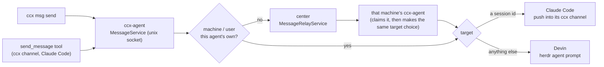
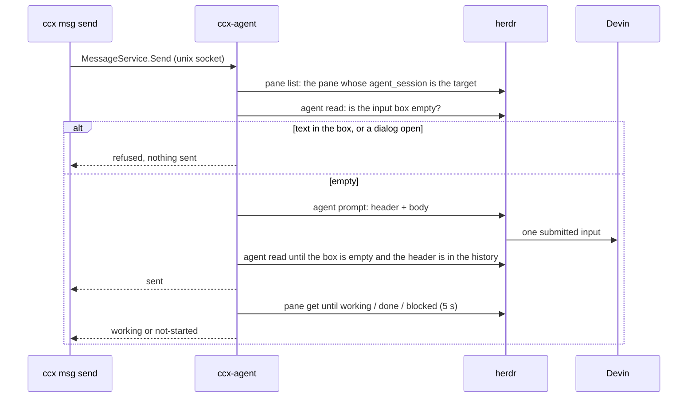
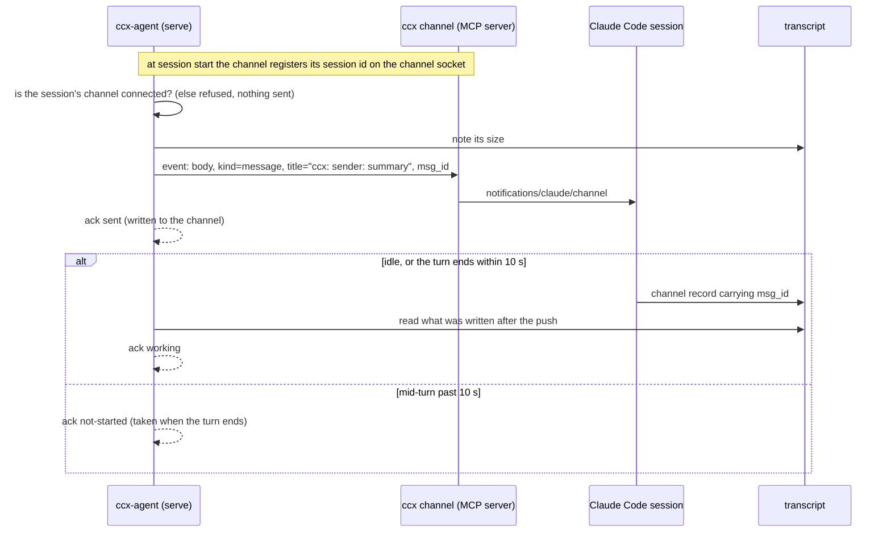
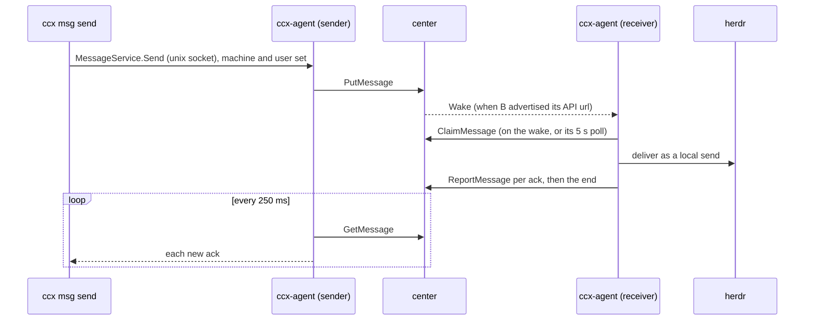

# Messages between running sessions

A session sends text to another running session, on this machine or another, with `ccx msg send` or, from a Claude Code session, the ccx channel's `send_message` tool. The sender names the receiver and how the message should be read; ccx-agent picks how to get it there and reports what happened. Receivers today are Devin (in a herdr pane) and Claude Code (through its ccx channel). Issue #301 holds the plan across products, #302 the Devin delivery, #138 the hop to another machine and the Claude Code side.

## Which way a message goes



- The sender never says what product the receiver is: a target shaped like a Claude Code session id (`8-4-4-4-12` hex) goes to Claude Code, anything else is a Devin session name. A Devin named in that shape would be taken for a Claude Code session; herdr names Devin sessions as words (`bird-baseball`).
- Each hop keeps the acks and the refusals unchanged, so the sender reads the same lines whichever way it went.

## What the sender sees

```bash
ccx msg send excited-giraffe --summary "review: 3 findings" --mode urgent "src/foo.ts: ..."
# sent  pane w164:p1
# working  agent_status working
```

- Each line is an ack, printed as it happens. Exit 0 means the message was sent. With `--wait` it also means the wait did not run out: a `done` came, or the receiver has no turn to wait on (a Claude Code session, below) and its acks ended as without `--wait`. From a ccx-agent older than `WAIT_ENDED` (below), a wait that ran out ends with exit 0 too.
- A `--wait` that ccx-agent says ran out (the ack state `WAIT_ENDED`, sent when its wait for the turn ends without a `done`) ends with `no done within <seconds> s (the receiver may still be on it)` and exit 3: the message is in, the answer did not come in time.
- A refusal prints `not sent: <reason>` and exits 1. Nothing was typed into the receiver.
- Any other failure prints `may have been sent` (or `sent, then lost the ack stream`) and exits 1: the text may be there already, so look before sending again. "not sent" needs ccx-agent's word for it (the error metadata `Ccx-Not-Typed: 1`, set on refusals before typing), a socket that could not be connected to, or a code the Connect layer answers before Send runs (Unimplemented from an older ccx-agent, ResourceExhausted for an oversized request); a dropped stream or a timeout (`--timeout`, 60 s) is not proof.
- The body is UTF-8 text up to 64 KiB with no control characters but newline and tab; sender and summary are one line of at most 40 and 80 bytes. At the limits the header is about 130 columns and wraps in a narrower pane; a wrapped header ends as `may have been sent`, so keep the summary short. Control and format characters (bidi overrides, zero-width spaces) are refused; the body keeps newline, tab and the zero-width joiners U+200C / U+200D that emoji sequences and some scripts need. The sender name is a label anyone on the machine can choose, not a checked identity.
- The receiver sees the first line `ccx: <sender>: <summary>`, then the body. Claude Code sees it as the channel event's `title` attribute.
- From a Claude Code session with the ccx channel, the `send_message` tool (`target`, `body`, `summary`, optional `mode` / `machine` / `user`) sends the same request through this machine's ccx-agent and returns the same lines, prefixed `not sent:` / `may have been sent` the same way. It refuses this session as the target, and sends one at a time (Claude Code calls tools in parallel; the 60 s starts when a send's turn comes, so time spent waiting does not cut its own delivery short).
- A Claude Code sender (the tool, or `ccx msg send` run inside a session) is named by its whole session id, so the receiver answers by sending to that id. An answer to another machine also needs that machine's name, which the message does not carry.

## Modes

| Mode | Meaning | Devin (this build) | Claude Code (this build) |
|---|---|---|---|
| `later` | Not woken; read on its next turn | `queued`; ccx-agent holds it and puts it into Devin's next turn through the `UserPromptSubmit` hook (below). Not typed into the pane | Refused, listing `after-turn` (needs the UserPromptSubmit inbox, #25) |
| `after-turn` (default) | Read once its current work is done; now if idle | Sent if idle. To a working Devin whose keymap binds Enter to `queue_message` (below), `sent` once it shows in Devin's queue, which Devin reads when the turn ends; with the default keymap, refused while herdr says working or the screen shows a turn | Sent; a session mid-turn takes it when the turn ends (the channel's own behaviour), so a turn running past 10 s ends the acks at `not-started` |
| `urgent` | Read at the next break, even while working | Sent; to a working Devin (herdr says working, or the screen shows a turn) `sent` is the last ack, since its status cannot show this message being picked up. With Enter bound to `queue_message`, ccx-agent sees it queued and presses `accept_line`'s key, which sends the whole queue on, the person's own queued messages too; refused if `accept_line` is on Enter or a same-header message is queued (below) | Refused, listing `after-turn`: a channel event never interrupts a turn (`transport.md`) |

- A mode the receiver lacks is refused, never swapped for a nearby one (#301).
- What Enter does in a running Devin turn depends on its keymap, which ccx-agent reads on each send to a working Devin, from the `--config` that Devin was started with (its argv from `herdr pane process-info`; the devin launcher and the binary it starts are both listed, the binary with the path made absolute, and an absolute `--config` is taken over a relative one; among relative ones, the first whose process has a cwd, taken against that cwd) or else from `~/.config/devin/config.json`; if herdr cannot list the pane's processes or lists no devin among them (or only relative `--config`s with no cwd), the send is refused rather than read from the default file (Devin clients share one background daemon, and a client whose `--config` differs from the daemon's is refused while the daemon has a busy session, unless started with `--process-model in-process`; devin 3000.13.4) (#86; an idle Devin submits on Enter whatever `accept_line` is, so a send to it does not read the keymap and a broken config does not stop it). By default it guides Devin (`Guide Devin while it works`, read at the next break). With `"keymap": {"readbox_input": {"queue_message": "enter"}, "editor": {"accept_line": "ctrl-enter"}}`, Enter queues the message (`── N queued ──` above the box) and `ctrl-enter` sends the queue at once, interrupting a running tool (devin 3000.12.57). herdr also reports `done` while a queue shows, so a queue on screen counts as a turn running (Devin sent it at each turn's end; a queue taller than the screen hides its rule and is not seen). When Enter queues, urgent is refused if `accept_line` is left on Enter or unset, and a send to a working Devin is refused while a message with the same header is already queued (its `○` line could stand for the new one).
- `after-turn` to a working Devin needs the end of its turn, which herdr does not report: `agent_status` also reads `idle` while Devin is still writing (#302). Devin's `Stop` hook reports it (below), but `after-turn` does not wait on it yet. Meanwhile ccx-agent also reads the screen: Devin draws `… (esc twice to interrupt)` while a turn runs (devin 3000.12.57), and `after-turn` is refused while it shows. A Devin that stops drawing that line would let `after-turn` in mid-turn again.

## Devin delivery



- `herdr agent prompt`, not `send-text` + Enter: the Enter can land before the paste and the text sits unsent (`transport.md`).
- The input box is read off the screen's styling: the box is the line starting with an unstyled `❭ ` with the box's rule right below it; the placeholder is drawn styled and typed text unstyled. A question or a permission prompt draws `❭` styled, so no box is found and nothing is sent. herdr reports a permission prompt as `done`, so its status alone would let a prompt type into the dialog.
- This reading was measured on devin 3000.12.57 only. A Devin that draws its screen differently fails closed when it no longer looks like an empty box (no send), but a change that draws typed text styled would read as empty and the message would be joined to the half-typed line. Check the fixtures in `apps/agent/internal/message/testdata` against a new Devin.
- One send at a time per ccx-agent, so two senders cannot both find the box empty and type into it together. A person typing into the pane between the check and the send is not covered: if their text stays in the box, or is submitted joined to the message (the header line is then no longer exactly the header), the send ends as `may have been sent`.
- "sent" needs one more history line that is exactly the header than before the send, so an earlier message with the same sender and summary (or a longer summary) does not count, and an empty box seen after that. A header that wraps in a narrow pane, or a box out of sight (a dialog the message opened right away, text too tall for the screen), ends as `may have been sent`. A `done` (or `blocked`) that was already there before the send is not counted as the message's turn starting; a `done` that follows an `idle` seen after the send is.
- Each send is logged by ccx-agent with target, sender, summary, mode and outcome.
- Only a Devin that herdr knows by name: `herdr agent start --kind devin` or `spawn-task --agent devin`. A Devin started another way has no session name in herdr and is not guessed.
- Served on the unix socket only. On the TCP listener anyone holding the API token could type into any session.

## Claude Code delivery



- The connection is the heartbeat's: each session's `ccx-agent channel` registers on serve's channel socket (`docs/design/heartbeat.md`), and the message goes down the same line as a heartbeat. With the heartbeat concern off there is no connection, and a send to a Claude Code session is refused.
- Only a session started with the ccx channel (`--dangerously-load-development-channels server:ccx`) can receive. A session with no ccx server at all (or with the heartbeat concern off) has nothing registered and is refused as not sent. A session that runs the ccx MCP server without that flag registers all the same, since the server cannot see the flag; Claude Code drops a channel notification from a server it has not loaded as a channel without a word (the Claude Code docs quoted in `transport.md`; not measured here), so that send would end `sent`, then `not-started`.
- `sent` means the event was written to the channel. Claude Code does not acknowledge a channel notification (`transport.md`); a session that had not loaded the server as a channel would drop it silently. The transcript is the proof: Claude Code writes the event there when a turn takes it in, so `working` is that record carrying this message's `msg_id`, looked for only in what was written after the push.
- The channel's instructions tell the session that `kind="message"` is from another session through ccx, that the sender is a label, and that `send_message` replies.

## Devin's hooks: later, question and done

```bash
ccx msg send excited-giraffe --summary "pick one" --wait 600 "Which of the two plans?"
# sent  pane w164:p1
# working  agent_status working
# question  prompt 7f3c…
#   plan: Which plan?
#     - A (keep the table)
#     - B (split it)
# done  prompt 7f3c…
#   Went with B: ...
```

- The screen cannot show what Devin asks or when its turn ends; its hooks can. Devin runs `ccx-agent devin-hook` for `UserPromptSubmit`, `PreToolUse` (only `ask_user_question` reaches ccx-agent) and `Stop`; the command passes the payload to ccx-agent on its unix socket (`MessageService.DevinHook`) and prints what comes back. It always exits 0 and prints nothing when ccx-agent is down, so a missing agent never fails Devin's turn.
- `--wait <seconds>` (up to 3600) keeps the send open after `sent`: a typed message's turn is the one whose `UserPromptSubmit` prompt is exactly the header and body typed (a `later` message's is the turn that took it, below). In that turn (the same `prompt_id`; devin 3000.12.57 gives every event of a turn the same one, and a Devin that does not would end the wait without `done`) each `ask_user_question` is a `question` ack with its questions and options (up to 8 such acks; each keeps 8 questions of 16 options, 4096 bytes a field), and the `Stop` is `done` with Devin's last answer (cut to 64 KiB here; the center keeps its last 4096 bytes for a relayed send). Control and format characters in what Devin wrote are dropped, as they are refused in a body. Running out of wait ends the stream with a `WAIT_ENDED` ack and no error, since the message is in either way; the CLI says so and exits 3. A ccx-agent older than that ack ends it with nothing, and the CLI exits 0.
- The CLI reads the stream with Bun's own cut of a silent response turned off (about 5 to 6 minutes: with Bun 1.4.3 a 420 s silence was cut at 360 s, with "The operation timed out."), so an unanswered question can be waited on for the whole `--wait` (#318); with `--wait` its bound is the longer of `--timeout` and `--wait` plus a minute.
- Two waiting sends of the same text (sender, summary and body) to one Devin each get one turn: the first such send still waiting takes the next such turn. Two turns starting close together can swap (each hook is its own process), and a send whose text Devin lost takes the next one's turn, leaving the later send to run out its wait. A send of the same text without `--wait` is not waiting for a turn, so a waiting one can take its turn too.
- A turn that another prompt cuts into (an `urgent` send while it runs) ends with no `Stop` of its own: Devin starts a new prompt and only that one stops (devin 3000.12.57, measured with two sends of the same text). The first send sees no `done` and runs out its wait.
- Devin waits for an answer to each question; a ninth question in the turn is not reported, so the sender sees no more until the wait runs out.
- `later` types nothing. ccx-agent keeps the text (up to 32 per session) and the next `UserPromptSubmit` of that session takes all of it as `additionalContext`, which Devin reads with the prompt and does not draw on screen. A hook call that ends (its 2 s budget) before the answer goes back leaves the messages for the next turn and reports no `sent`; an answer lost after that check is not seen, since Devin does not acknowledge it. Messages put back go ahead of those queued since, but behind any another hook call took meanwhile, and can briefly hold more than 32. With `--wait`, the turn taking it gives `sent  taken by prompt …`, then `question` / `done` as above.
- A prompt typed while Devin runs a tool (a background shell) is accepted by herdr and lost: no `UserPromptSubmit` fires (devin 3000.12.57, #302). `later` does not hit this, since nothing is typed.
- Through the center, each delivery types in claim order and the next starts once one has typed, so one long `--wait` does not hold the rest; the center keeps up to 16 acks a message.
- The hooks go in Devin's config (`~/.config/devin/config.json`), one entry per event, command `ccx-agent devin-hook`; `ccx hooks install devin` (or `install.sh --with-agent --hooks devin`) adds them, and a running Devin reads them when it starts again. Without them `later` stays queued and `--wait` sees no `question` / `done`; the ack line for `queued` says which hook takes it.
- `--wait` to a Claude Code session changes nothing: its acks end as above, with no `question` / `done` yet.

## Another machine

```bash
ccx msg send -m ccx1 excited-giraffe --summary "review: 3 findings" --mode urgent "src/foo.ts: ..."
```

- `-m <machine>` / `-u <user>` name the ccx-agent that delivers it, the same flags as `ccx session resume`. Either left out is this agent's own; both left out (or naming this agent) is a local send. The names are matched as they are, case included: the machine is the name that agent goes by (its `uname -n`), which can differ from an ssh host name. A machine / user that no ccx-agent has ever asked this center for messages as (each asks every few seconds) is refused at once as `not sent`, listing the pairs that have asked (those differing in case alone first), instead of waiting out the 30 s below. The center keeps every pair that ever asked, so an agent that stopped still gets the 30 s, and a retired machine stays in that list. A center new to this check knows no pair until each agent next asks, a few seconds after it starts.
- The receiving ccx-agent delivers it exactly as a local send, so the modes, refusals and acks above hold unchanged. The sender sees the same lines; an error from the other side or the center names it as `<machine>/<user>`.



- The connections go ccx-agent → center, as for ingest and resume; the center reaches a ccx-agent only to wake it, and a missed wake waits for the receiver's 5 s poll.
- A message is handed out once. One the receiver claimed and never finished (it died mid-send) is not handed out again, so it is never typed twice; the sender ends at its `--timeout` as `may have been sent`, or `sent, then lost the ack stream` when `sent` had come back.
- One not claimed within 30 s of the put is never handed out, and the sender says `not sent`. The receiver claims each message as it comes and keeps the claimed ones in a queue it delivers in order, so a message waiting behind another one is not lost to the 30 s; only a receiver that is down, not pointed at this center, or holding 64 claimed messages not yet delivered (those still waiting with `--wait` included) lets it pass. A receiver that stops with messages in its queue leaves their senders at `may have been sent`.
- A sender still waiting two hours after the put (a `--timeout` over two hours) finds the message gone from the center and ends as `may have been sent`.
- A put the center refused (bad token, invalid request) or whose connection was refused is `not sent`. Any other failure (a timeout, a lost answer, and also a DNS or TLS failure, which this does not tell apart) may have stored it, so it ends as `may have been sent`.
- The relayed message names where it goes, not where it came from: the receiver logs the center's id with the delivery, and the sender is only the `--from` label. Which machine sent it is not recorded.
- The center keeps a message, body included, for two hours after it was put (a `--wait` can last an hour), and drops it on a later put.
- The relay runs on every ccx-agent with an http(s) center and a machine and user name. Receiving needs no other setting; the wake needs the API url that the resume concern advertises (`docs/design/resume.md`).
- Anyone holding the center's token can put a message for any machine, and claim and read one meant for another. That is the reach the token already has through resume, which starts sessions anywhere; MessageService itself stays off the agent's TCP listener.

## Not built yet

- `after-turn` to a working Devin with the default keymap (it could queue like `later` and be taken by the next turn; today it is refused).
- `later` and `--wait` survive no restart of ccx-agent: queued messages and waiting sends live in its memory. A session that never takes another turn keeps its queued messages (up to 32) until ccx-agent restarts.
- Through the center, a receiver holds at most 64 messages claimed and not yet delivered, those waiting (`--wait`) included; past that it claims no more, and messages put meanwhile pass the 30 s and end as `not sent`.
- `question` / `done` for Claude Code.
- `later` and `urgent` for Claude Code, and receivers other than Devin and Claude Code (OpenCode, agy, pi; #301).
- A way to list the reachable sessions across machines (the sender has to know the machine and the target).
