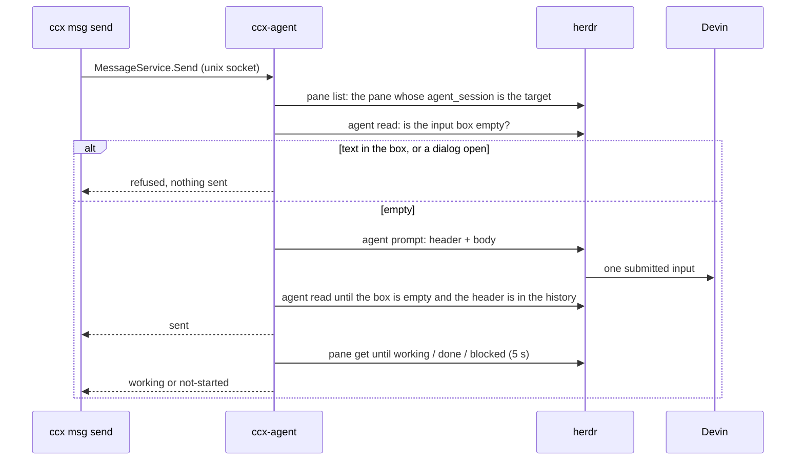
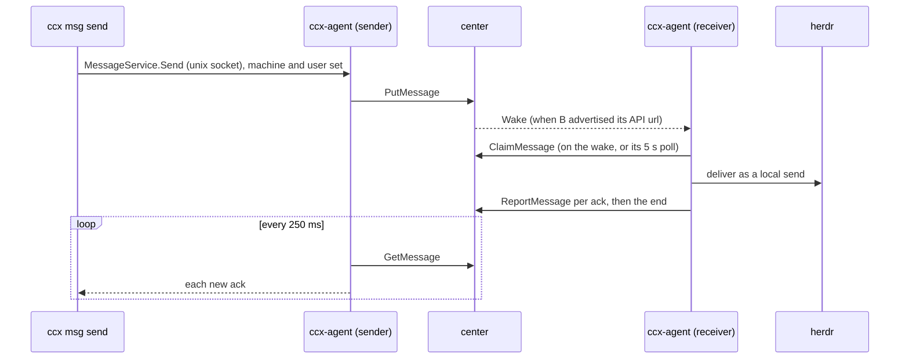

# Messages between running sessions

A session sends text to another running session with `ccx msg send`, on this machine or another. The sender names the receiver and how the message should be read; ccx-agent picks how to get it there and reports what happened. Issue #301 holds the plan across products, #302 the Devin delivery built here, #138 the hop to another machine.

## What the sender sees

```bash
ccx msg send excited-giraffe --summary "review: 3 findings" --mode urgent "src/foo.ts: ..."
# sent  pane w164:p1
# working  agent_status working
```

- Each line is an ack, printed as it happens. Exit 0 means the message was sent.
- A refusal prints `not sent: <reason>` and exits 1. Nothing was typed into the receiver.
- Any other failure prints `may have been sent` (or `sent, then lost the ack stream`) and exits 1: the text may be there already, so look before sending again. "not sent" needs ccx-agent's word for it (the error metadata `Ccx-Not-Typed: 1`, set on refusals before typing), a socket that could not be connected to, or a code the Connect layer answers before Send runs (Unimplemented from an older ccx-agent, ResourceExhausted for an oversized request); a dropped stream or a timeout (`--timeout`, 60 s) is not proof.
- The body is UTF-8 text up to 64 KiB with no control characters but newline and tab; sender and summary are one line of at most 40 and 80 bytes. At the limits the header is about 130 columns and wraps in a narrower pane; a wrapped header ends as `may have been sent`, so keep the summary short. Control and format characters (bidi overrides, zero-width spaces) are refused; the body keeps newline, tab and the zero-width joiners U+200C / U+200D that emoji sequences and some scripts need. The sender name is a label anyone on the machine can choose, not a checked identity.
- The receiver sees the first line `ccx: <sender>: <summary>`, then the body.

## Modes

| Mode | Meaning | Devin (this build) |
|---|---|---|
| `later` | Not woken; read on its next turn | Refused, listing `after-turn, urgent` |
| `after-turn` (default) | Read once its current work is done; now if idle | Sent if idle; refused while herdr says working or the screen shows a turn |
| `urgent` | Read at the next break, even while working | Sent; to a working Devin (herdr says working, or the screen shows a turn) `sent` is the last ack, since its status cannot show this message being picked up |

- A mode the receiver lacks is refused, never swapped for a nearby one (#301).
- `after-turn` to a working Devin needs the end of its turn, which herdr does not report: `agent_status` also reads `idle` while Devin is still writing (#302). The end of the turn is Devin's `Stop` hook, not wired to ccx-agent yet. Until then ccx-agent also reads the screen: Devin draws `… (esc twice to interrupt)` while a turn runs (devin 3000.12.57), and `after-turn` is refused while it shows. A Devin that stops drawing that line would let `after-turn` in mid-turn again.

## Devin delivery



- `herdr agent prompt`, not `send-text` + Enter: the Enter can land before the paste and the text sits unsent (`transport.md`).
- The input box is read off the screen's styling: the box is the line starting with an unstyled `❭ ` with the box's rule right below it; the placeholder is drawn styled and typed text unstyled. A question or a permission prompt draws `❭` styled, so no box is found and nothing is sent. herdr reports a permission prompt as `done`, so its status alone would let a prompt type into the dialog.
- This reading was measured on devin 3000.12.57 only. A Devin that draws its screen differently fails closed when it no longer looks like an empty box (no send), but a change that draws typed text styled would read as empty and the message would be joined to the half-typed line. Check the fixtures in `apps/agent/internal/message/testdata` against a new Devin.
- One send at a time per ccx-agent, so two senders cannot both find the box empty and type into it together. A person typing into the pane between the check and the send is not covered: if their text stays in the box, or is submitted joined to the message (the header line is then no longer exactly the header), the send ends as `may have been sent`.
- "sent" needs one more history line that is exactly the header than before the send, so an earlier message with the same sender and summary (or a longer summary) does not count, and an empty box seen after that. A header that wraps in a narrow pane, or a box out of sight (a dialog the message opened right away, text too tall for the screen), ends as `may have been sent`. A `done` (or `blocked`) that was already there before the send is not counted as the message's turn starting; a `done` that follows an `idle` seen after the send is.
- Each send is logged by ccx-agent with target, sender, summary, mode and outcome.
- Only a Devin that herdr knows by name: `herdr agent start --kind devin` or `spawn-task --agent devin`. A Devin started another way has no session name in herdr and is not guessed.
- Served on the unix socket only. On the TCP listener anyone holding the API token could type into any session.

## Another machine

```bash
ccx msg send -m ccx1 excited-giraffe --summary "review: 3 findings" --mode urgent "src/foo.ts: ..."
```

- `-m <machine>` / `-u <user>` name the ccx-agent that delivers it, the same flags as `ccx session resume`. Either left out is this agent's own; both left out (or naming this agent) is a local send.
- The receiving ccx-agent delivers it exactly as a local send, so the modes, refusals and acks above hold unchanged. The sender sees the same lines; an error from the other side or the center names it as `<machine>/<user>`.



- The connections go ccx-agent → center, as for ingest and resume; the center reaches a ccx-agent only to wake it, and a missed wake waits for the receiver's 5 s poll.
- A message is handed out once. One the receiver claimed and never finished (it died mid-send) is not handed out again, so it is never typed twice; the sender ends at its `--timeout` as `may have been sent`, or `sent, then lost the ack stream` when `sent` had come back.
- One not claimed within 30 s of the put is never handed out, and the sender says `not sent`. The receiver claims each message as it comes and keeps the claimed ones in a queue it delivers in order, so a message waiting behind another one is not lost to the 30 s; only a receiver that is down, not pointed at this center, or holding about 64 claimed messages not yet delivered lets it pass. A receiver that stops with messages in its queue leaves their senders at `may have been sent`.
- A sender still waiting an hour after the put (a `--timeout` over an hour) finds the message gone from the center and ends as `may have been sent`.
- A put the center refused (bad token, invalid request) or whose connection was refused is `not sent`. Any other failure (a timeout, a lost answer, and also a DNS or TLS failure, which this does not tell apart) may have stored it, so it ends as `may have been sent`.
- The relayed message names where it goes, not where it came from: the receiver logs the center's id with the delivery, and the sender is only the `--from` label. Which machine sent it is not recorded.
- The center keeps a message, body included, for an hour after it was put, and drops it on a later put.
- The relay runs on every ccx-agent with an http(s) center and a machine and user name. Receiving needs no other setting; the wake needs the API url that the resume concern advertises (`docs/design/resume.md`).
- Anyone holding the center's token can put a message for any machine, and claim and read one meant for another. That is the reach the token already has through resume, which starts sessions anywhere; MessageService itself stays off the agent's TCP listener.

## Not built yet

- `question` and `done` acks, from Devin's `PreToolUse` (`ask_user_question`) and `Stop` hooks (#302).
- `later` for Devin, and `after-turn` to a working Devin.
- Receivers other than Devin (#301), among them a Claude Code session through its ccx channel (#138), and a send tool on the channel's MCP server (#301 puts the CLI first).
