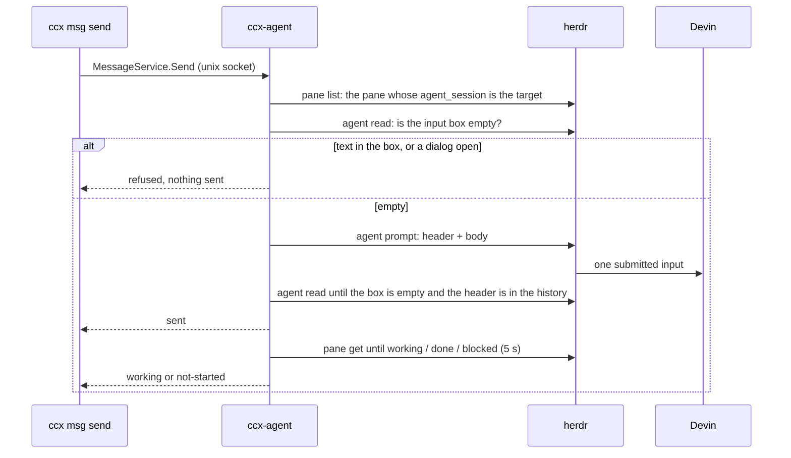

# Messages between running sessions

A session sends text to another running session with `ccx msg send`. The sender names the receiver and how the message should be read; ccx-agent picks how to get it there and reports what happened. Issue #301 holds the plan across products, #302 the Devin delivery built here, #138 the hop to another machine.

## What the sender sees

```bash
ccx msg send excited-giraffe --summary "review: 3 findings" --mode urgent "src/foo.ts: ..."
# sent  pane w164:p1
# working  agent_status working
```

- Each line is an ack, printed as it happens. Exit 0 means the message was sent.
- A refusal prints `not sent: <reason>` and exits 1. Nothing was typed into the receiver.
- Any other failure prints `may have been sent` (or `sent, then lost the ack stream`) and exits 1: the text may be in the receiver already, so look before sending again.
- The body is UTF-8 text up to 64 KiB with no control characters but newline and tab. The sender name is a label anyone on the machine can choose, not a checked identity.
- The receiver sees the first line `ccx: <sender>: <summary>`, then the body.

## Modes

| Mode | Meaning | Devin (this build) |
|---|---|---|
| `later` | Not woken; read on its next turn | Refused, listing `after-turn, urgent` |
| `after-turn` (default) | Read once its current work is done; now if idle | Sent if idle; refused while working |
| `urgent` | Read at the next break, even while working | Sent |

- A mode the receiver lacks is refused, never swapped for a nearby one (#301).
- `after-turn` to a working Devin needs the end of its turn, which herdr does not report: `agent_status` also reads `idle` while Devin is still writing (#302). The end of the turn is Devin's `Stop` hook, not wired to ccx-agent yet. Until then `after-turn` is best effort: it is refused only while herdr says `working`, and a send while Devin is still writing goes in mid-turn.

## Devin delivery



- `herdr agent prompt`, not `send-text` + Enter: the Enter can land before the paste and the text sits unsent (`transport.md`).
- The input box is read off the screen's styling: the box is the line starting with an unstyled `❭ ` with the box's rule right below it; the placeholder is drawn styled and typed text unstyled. A question or a permission prompt draws `❭` styled, so no box is found and nothing is sent. herdr reports a permission prompt as `done`, so its status alone would let a prompt type into the dialog.
- This reading was measured on devin 3000.12.57 only. A Devin that draws its screen differently fails closed when it no longer looks like an empty box (no send), but a change that draws typed text styled would read as empty and the message would be joined to the half-typed line. Check the fixtures in `apps/agent/internal/message/testdata` against a new Devin.
- One send at a time per ccx-agent, so two senders cannot both find the box empty and type into it together.
- "sent" needs a new copy of the header line in the history, so an earlier message with the same sender and summary does not count. `working` from a Devin that was already `done` before the send is not counted either.
- Each send is logged by ccx-agent with target, sender, summary, mode and outcome.
- Only a Devin that herdr knows by name: `herdr agent start --kind devin` or `spawn-task --agent devin`. A Devin started another way has no session name in herdr and is not guessed.
- Served on the unix socket only. On the TCP listener anyone holding the API token could type into any session.

## Not built yet

- `question` and `done` acks, from Devin's `PreToolUse` (`ask_user_question`) and `Stop` hooks (#302).
- `later` for Devin, and `after-turn` to a working Devin.
- Receivers other than Devin (#301) and other machines (#138).
