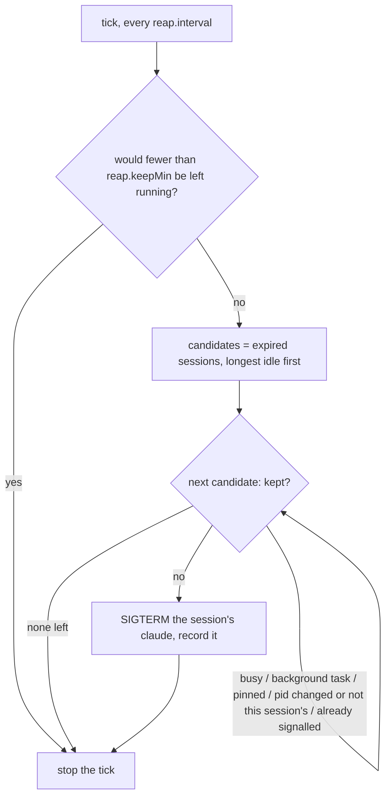

# Reclaiming idle sessions once keepalive has let go

Design for #117 (kaneo ccx#98). Names and scope decided by the user on 2026-11-22.

## To-Be

- A session that keepalive has stopped beating, and whose prompt cache has expired, is stopped by `ccx-agent` with SIGTERM. Its transcript stays, so `claude --resume` brings it back; what it loses is only the memory it held.
- Nothing is stopped silently: every reclaim leaves a record (when, why, how much memory came back) in serve's log and on the session itself.
- Off by default. A person turns it on in ccx's config; ccx then carries out that policy. This answers #102's "ccx-agent does not choose which session to stop": the person chose the rule, the agent applies it.

## Why keepalive is the trigger

- A resident session is worth three things (user, 2026-11-20): it is in view, keepalive keeps its cache warm for about 12 hours, and it is already up when work is handed to it.
- Once the last heartbeat is older than the cache TTL, the second is gone. Stopping it then costs the first and third only, and frees its memory (on d1, 2026-09-13: 18 sessions, Claude Code itself 6.72G PSS, MCP 2.51G).
- So the clock is the heartbeat's own: a session is *expired* when heartbeats have stopped for it (`maxIdle` passed since the last real use) and the cache TTL has run out since the later of its last request and last heartbeat. Age alone is not used.

## When a session is stopped

- One session per tick at most. SIGTERM runs Claude Code's SessionEnd hook (re-measured 2026-11-20 on d1, Claude Code 2.1.329: 2 of 2, `reason=other`; SIGKILL 0), and several at once make hooks drop work (claude-config#46), so reclaims are spaced by `reap.interval`.
- Only sessions with a registered `ccx-agent channel` are candidates. The channel reports its parent pid (Claude Code spawns it directly). serve reads that pid's `/proc/<pid>/stat` when the channel registers: its command must be `claude` and it must not be a zombie (`Z`) or dead (`X`), and its start time is kept. A registration whose pid is missing or is not such a process is logged once and never reaped. The pid and `~/.claude/sessions/<pid>.json` (Claude Code's own record of that process) are checked before the process tree is measured, so a candidate that is not its process's session costs no walk of `/proc`. After the walk, right before the signal, everything is checked again, in this order: the session is still expired (not pinned, not used, no tool or background task started), then the process is still the same command and start time and the pid file still names this session, so the last pid-file read is the one nearest the signal; and the session still leaves keepMin running. Only if all of it holds is the signal sent.
- Candidates go longest idle first, by the clock the expiry test counts (the later of the last real use and the process start). A resumed old transcript is as fresh as its process, and a transcript with no real record is not older than the rest.
- A process is signalled once. serve marks it signalled in memory, and the record (below) carries the pid, start time and boot id; a new registration (serve restarted, the channel reconnected) reads the session's `reaped` file at once and starts out signalled if the process is in it, so it is neither signalled again nor counted by keepMin. A signal that fails is not marked, and the session is tried again on a later tick.
- keepMin counts the sessions left running: registered, and not already signalled. A session that was signalled and is still exiting does not count. The count is taken again under the lock right before the signal.
- The idle clock starts no earlier than the process: `maxIdle` and the cache TTL are both counted from the later of the transcript's last use and the process start, so a freshly resumed old transcript is not reaped on the spot.
- Not stopped:
  - a turn is running (`Scan.ToolRunning`, or input waiting for its response): the heartbeat's own test
  - a background task is alive: a `run_in_background` Bash, a Monitor or an async agent whose start is in the transcript after the current process started, with no `<task-notification>` for its task id yet. A start is read from a tool's result only for the tool that writes it, told by the `tool_use` that asked for it: a Bash's `backgroundTaskId`, a Monitor's `taskId`, an Agent's `agentId` with `async_launched`, and a TaskStop's `task_id` as an end (names seen on d1: Bash 5,153, Agent 2,407, TaskStop 163, Monitor 5); a result of another tool, or of a tool never seen, starts and ends nothing. A record can carry several notifications and each is read on its own: only its own `<status>`, or an `<event>` whose text starts with `[Monitor expired`, ends that notification's task ids. Text inside `<event>`, `
` or `<result>` (a command's output can quote anything, other tasks' ids and tags included, even a whole notification) is removed from the record before it is split into notifications, and ends nothing and names no task. A literal closing tag with no opening one inside such output is not handled. Starts before the process started are dropped: a resume does not carry them (300 transcripts on d1, 2026-11-22: 4,298 starts, 2,948 notified; the rest are mostly from earlier processes)
  - pinned: the top-level declared key `pinned` (`~/.claude/sessions/<id>/pinned`, set with `ccx session pin`; user decision 2026-11-22)
- Not considered: a session waiting on a person's answer elsewhere (a review tool, a decision queue). The window is a person answering across the moment keepalive ends; little is lost and the case is rare (user decision 2026-11-22). Detecting it belongs to that tool (akapen#343), not to ccx.
- Not built: a memory-pressure brake. Once keepalive reclaims sessions it is rarely needed, and it ties ccx to the host's memory accounting (user decision 2026-11-22).
- Fail closed: an unreadable transcript, an unknown pid, a pid file that cannot be read or names another session keeps the session.

### `/clear`

- After `/clear` the same `claude` process runs a new session id while its channel stays registered under the old one. The reaper tells them apart by `~/.claude/sessions/<pid>.json`'s `sessionId`.
- Measured on Claude Code 2.1.330 (d1, 2026-11-22, a throwaway interactive session): after `/clear` the file's `sessionId` changed to the new id within 5 seconds. So the old registration stops matching and is kept.
- This depends on Claude Code rewriting that field. A version that stopped rewriting it would leave the old id matching, and the reaper would stop the process now running the new session. Re-measure when Claude Code changes how it writes the pid file.

## Record

- serve's log: `reap: stopped <session> (expired, <MiB> MiB, idle <dur>)`.
- On the session: `~/.claude/sessions/<id>/reaped`, one JSON line per reclaim, `{"at", "reason": "expired", "pid", "pssBytes", "start", "boot"}` (`start` is the process's start time in clock ticks since boot and `boot` the host's boot id, `/proc/sys/kernel/random/boot_id`; with `pid` they name the process, and `start` alone repeats after a reboot; a record without `boot` matches no process), so `ccx session ls` and a resume list can say why a session is gone.
- At the center: the same record goes into collect's spool as an event with its own producer (as declared state does with `PRODUCER_CCX_SESSION_STATE`). Without a center, or while it is down, it waits in the spool; the local record is written either way (user decision 2026-11-22: works without a center, managed at the center).
- Freed memory is the stopped process tree's PSS read just before the signal (`/proc/<pid>/smaps_rollup`), not a before/after of the host, which other sessions move.

## Settings

| What | config.toml `[reap]` | env | default |
|---|---|---|---|
| on/off | `enabled` | `CCX_REAP` | off |
| spacing between reclaims, and tick (at least `10s`) | `interval` | `CCX_REAP_INTERVAL` | `1m` |
| sessions always left running | `keepMin` | `CCX_REAP_KEEP_MIN` | `0` |

- Env, then `config.toml`; there is no git config source (git config is being taken out of the resolution, kaneo ccx#24, and new settings do not start there). Env values are trimmed.
- An unusable value (an interval that is not a duration of at least 10s, a keepMin that is not a count of 0 or more, a value of the wrong type in the file) turns reaping off with every reason in serve's log; nothing else is affected.
- The reaper runs inside the heartbeat concern: it needs that concern on, and the channel's registration. With reaping on and the heartbeat concern off, serve logs `reap on but the heartbeat concern is off: nothing will be reaped`. It also needs the heartbeat's `maxIdle` (an expired session is one keepalive has let go of); with `maxIdle` off, serve logs `reap on but the heartbeat maxIdle is off: nothing will be reaped`.
- A file value of the wrong type (`keepMin` must be an integer, `interval` a non-empty string, `enabled` a bool) is unusable even when an env value overrides it. A `CCX_REAP` that is not a bool is unusable too, and reaping stays off.
- Hosts without `/proc` (macOS) never reap: pid, start time and PSS are all read from it, and a session whose process cannot be checked is kept.

## Not in scope

- Sessions without the ccx channel: nothing tells serve their pid and transcript reliably.
- Restarting them: resume is #102 / `docs/design/resume.md`.
- Visibility of keepalive itself (#188 / #274): this design reads the same scan and does not depend on them.

## Residual risks

- The signal is not sent through a pidfd. The window between the last check and `kill` is one system call, and pidfd needs `x/sys` or raw system calls; not worth it now.
- Right after `/clear` the pid file is rewritten within about 5 seconds (measured). A tick that lands in that window needs the old registration to be expired at that exact moment; the window is small and the cost is a session stopped one moment early, resumable from its transcript.
- A partially written last transcript line is not guarded: an expiry needs `maxIdle` (12h by default) with no real use, and a partial assistant line always follows a fresh input record, which would already have made the session not expired.
- `collect` must hold the spool for the record to reach the center. The reaper's write is refused while collect is not running (startup, shutdown); the local `reaped` file and the log are written anyway, and the missing event is logged.
