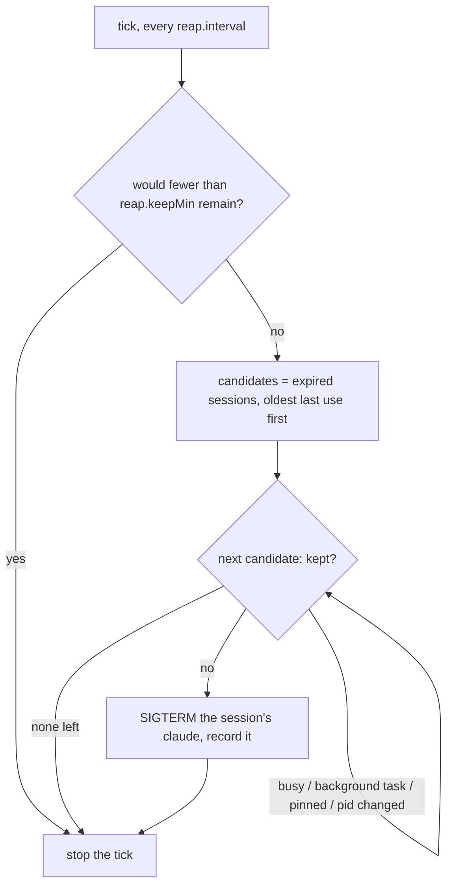

# Reclaiming idle sessions once keepalive has let go

Design for #117 (kaneo ccx#98). Names and scope decided by the user on 2026-11-22.

## To-Be

- A session that keepalive has stopped beating, and whose prompt cache has expired, is stopped by `ccx-agent` with SIGTERM. Its transcript stays, so `claude --resume` brings it back; what it loses is only the memory it held.
- Nothing is stopped silently: every reclaim leaves a record (when, why, how much memory came back) in serve's log and on the session itself.
- Off by default. A person turns it on in ccx's config; ccx then carries out that policy. This answers #102's "ccx-agent does not choose which session to stop": the person chose the rule, the agent applies it.

## Why keepalive is the trigger

- A resident session is worth three things (user, 2026-11-20): it is in view, keepalive keeps its cache warm for about 12 hours, and it is already up when work is handed to it.
- Once the last heartbeat is older than the cache TTL, the second is gone. Stopping it then costs the first and third only, and frees its memory (on d1, 2026-09-13: 18 sessions, Claude Code itself 6.72G PSS, MCP 2.51G).
- So the clock is the heartbeat's own: a session is *expired* when heartbeats have stopped for it (`maxIdle` passed since the last real use) and the cache TTL has run out since the later of its last request and last heartbeat. Age alone is not used.

## When a session is stopped

- One session per tick at most. SIGTERM runs Claude Code's SessionEnd hook (re-measured 2026-11-20 on d1, Claude Code 2.1.329: 2 of 2, `reason=other`; SIGKILL 0), and several at once make hooks drop work (claude-config#46), so reclaims are spaced by `reap.interval`.
- Only sessions with a registered `ccx-agent channel` are candidates. The channel reports its parent pid (Claude Code spawns it directly), and serve checks that pid is still a `claude` process started before the channel registered, so a recycled pid is never signalled.
- Not stopped:
  - a turn is running (`Scan.ToolRunning`, or input waiting for its response): the heartbeat's own test
  - a background task is alive: a `run_in_background` Bash, a Monitor or an async agent whose start is in the transcript after the current process started, with no `<task-notification>` for its tool-use id yet. Starts before the process started are dropped: a resume does not carry them (300 transcripts on d1, 2026-11-22: 4,298 starts, 2,948 notified; the rest are mostly from earlier processes)
  - pinned: the top-level declared key `pinned` (`~/.claude/sessions/<id>/pinned`, set with `ccx session pin`; user decision 2026-11-22)
- Not considered: a session waiting on a person's answer elsewhere (a review tool, a decision queue). The window is a person answering across the moment keepalive ends; little is lost and the case is rare (user decision 2026-11-22). Detecting it belongs to that tool (akapen#343), not to ccx.
- Not built: a memory-pressure brake. Once keepalive reclaims sessions it is rarely needed, and it ties ccx to the host's memory accounting (user decision 2026-11-22).
- Fail closed: an unreadable transcript or an unknown pid keeps the session.

## Record

- serve's log: `reap: stopped <session> (<reason>, <MiB> freed, idle <dur>)`.
- On the session: `~/.claude/sessions/<id>/reaped`, one JSON line per reclaim, `{"at", "reason": "expired", "pid", "pssBytes"}`, so `ccx session ls` and a resume list can say why a session is gone.
- At the center: the same record goes into collect's spool as an event with its own producer (as declared state does with `PRODUCER_CCX_SESSION_STATE`). Without a center, or while it is down, it waits in the spool; the local record is written either way (user decision 2026-11-22: works without a center, managed at the center).
- Freed memory is the stopped process tree's PSS read just before the signal (`/proc/<pid>/smaps_rollup`), not a before/after of the host, which other sessions move.

## Settings

| What | config.toml `[reap]` | env | default |
|---|---|---|---|
| on/off | `enabled` | `CCX_REAP` | off |
| spacing between reclaims, and tick | `interval` | `CCX_REAP_INTERVAL` | `1m` |
| sessions always left running | `keepMin` | `CCX_REAP_KEEP_MIN` | `0` |

- git config keys are `ccx.reap`, `ccx.reapInterval` and `ccx.reapKeepMin`, resolved env, then git config, then `config.toml`, as the heartbeat's are.
- An unusable value (an interval that is not a positive duration, a keepMin that is not a count of 0 or more) turns reaping off with the reason in serve's log; nothing else is affected.
- The reaper runs inside the heartbeat concern: it needs that concern on, and the channel's registration.
- Hosts without `/proc` (macOS) never reap: pid, start time and PSS are all read from it, and a session whose process cannot be checked is kept.

## Not in scope

- Sessions without the ccx channel: nothing tells serve their pid and transcript reliably.
- Restarting them: resume is #102 / `docs/design/resume.md`.
- Visibility of keepalive itself (#188 / #274): this design reads the same scan and does not depend on them.
